# 2026-10-28 WEN 오늘의 TIL(Git 정보)

---
### 1. Git 터미널에서

한번에 add, commit 하는 방벙 : git add .  &&  git commit -m “~~~”

과거 히스토리에서 명령어 가져오고 싶으면 !번호 하면 됨

Git으로 관리할 필요없는 파일들 관리할 수 있어야 해

→ .gitlgnore 을 만들어주면 됨 ( . 파일이라 숨김 파일임)

이 파일 안에  *.확장자 하면 그 파일은 이제 git에서 추적하지 않음.

이때, 대소문자가 신경쓰일 수 있을텐데, 이때는 [대,소문자]나머지 확장자명 하면 둘 다 된다.

여기서, 다시 복습하자면, Git을 만들고 원격으로 올리려면 git remote add origin URL 하면 연결이 된다.

git remote -v를 확인해보면 나온다.

---

### 2. Git 정보

git log —oneline하면 나오는 정보가 있을텐데 이때, 초록색은 로컬이고, 빨간색은 원격이다.

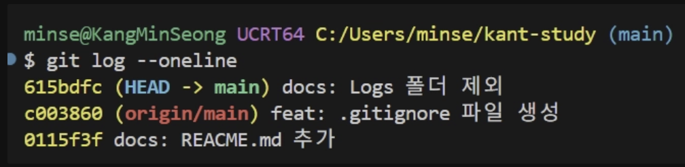

이건 로컬에서 작업한 내용이 아직 올라가지 않은 상태이고

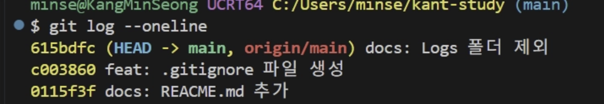

이렇게 한 줄로 된다면 로컬에서 원격으로 올라왔다는 것이다.

→ 이제 어디서 뭘 올리고, 어디에 올라가는지도 꼭 알아야한다. 나중에 혼돈이 올 수 있음.

TIP. vsc에서 선택 문장에서 alt 누르고 방향키 누르면 움직임 

---

### 3. clone 하는 방법

만약, 없는 상태에서 파일 및 폴더를 가져와야할 상황이라면 clone을 해야한다.

git clone 주소 하면 된다

---

### 4. git commit 메시지 컨벤션

기능 별로 메시지가 다른데 이때,

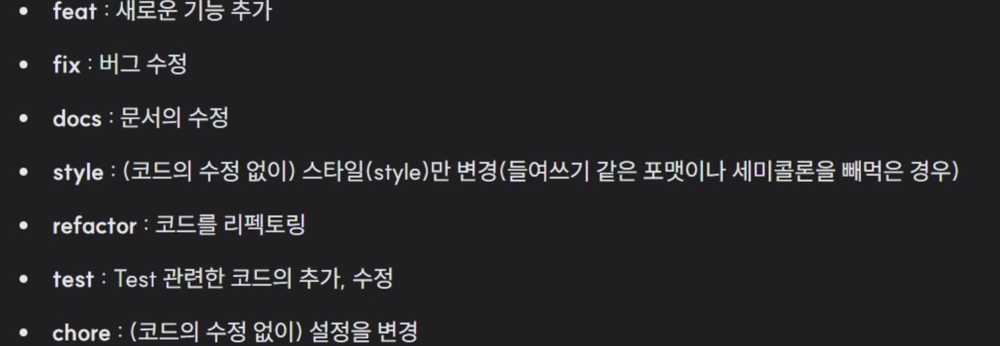

이걸 참고하면 된다.

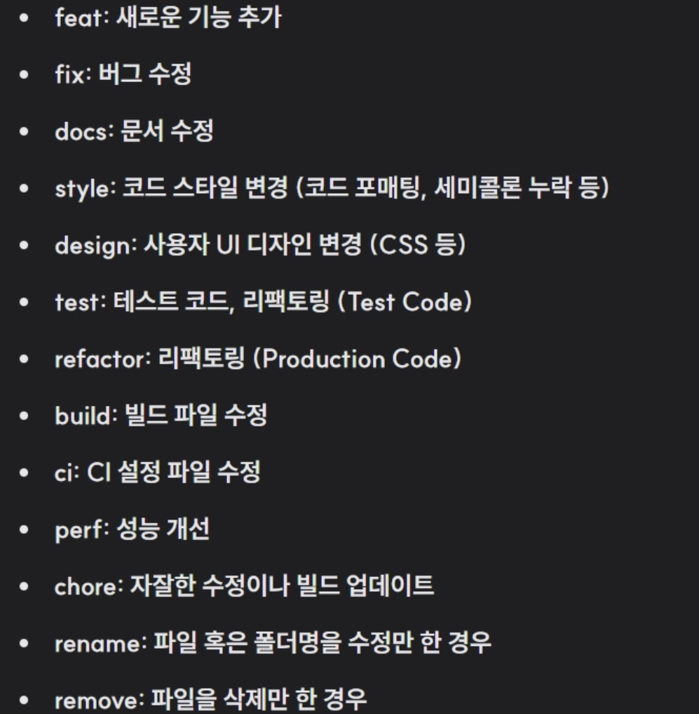

더 나아가 이것까지 사용하면 좋다.

---

### 4. reset 하는 방법

1. **soft : git reset --soft 해시값(돌아가고 싶은 곳)**

→ 지운다라고 생각하지말고, 되돌아간다로 생각하자.

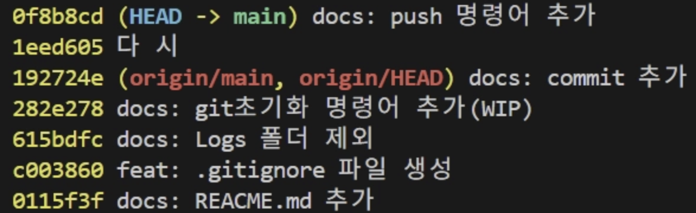

이 상황에서 reset —soft를 하면 ,

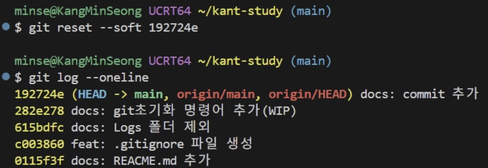

되돌아간다.

정리하자면, 리포에서 사라지고, stayarea, work 디렉터리에는 남아있는다.

2. **mixed(기본값) : git reset —mise**

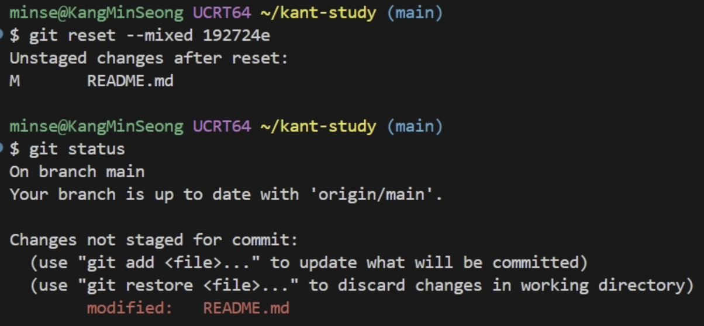

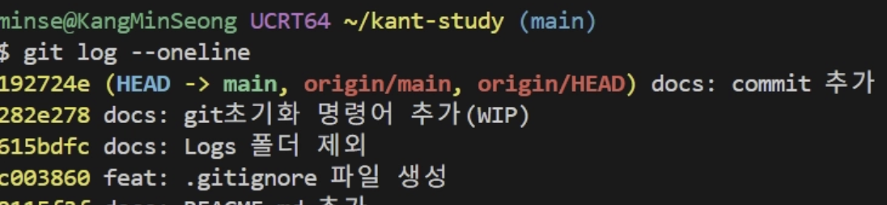

정리하자면, 리포에 없고, stayarea에도 없고, 디렉터리에는 남아있는다.

3. **hard  : git rest —hard 해시값**  

(git reset HEAD@{번호}) 이건 reflog을 했을때 → 이건 이제 git reflog를 하고, 여기서 reflog는 뭐냐 우리가 했던 commit, add 했던 로그를 다 보여준다.

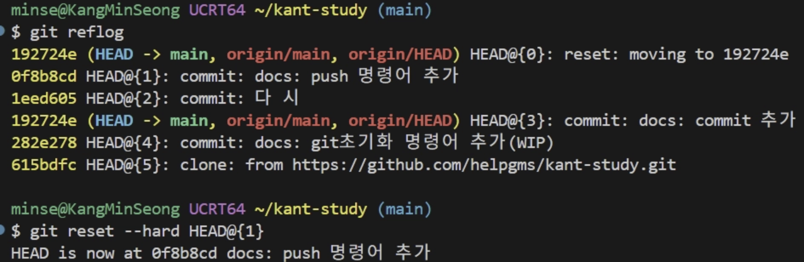

head 옵션 명령어 과정

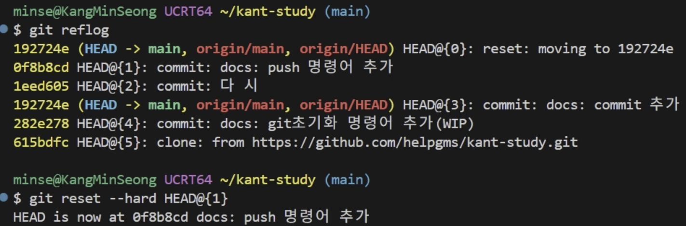

head 옵션 결과

이젠 해시값 명령어 

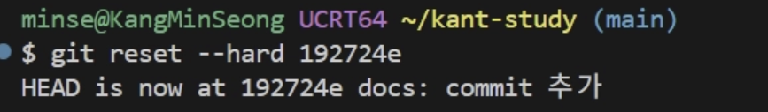

결과

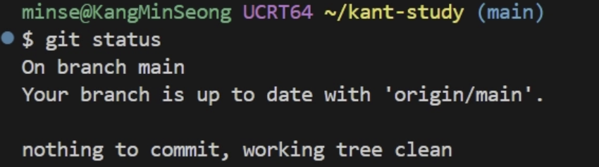

정리하자면, 워킹디렉터리까지 깔끔하게 없어진다.

### 5. branch 활용

git branch 브랜치명 하면 생긴다.

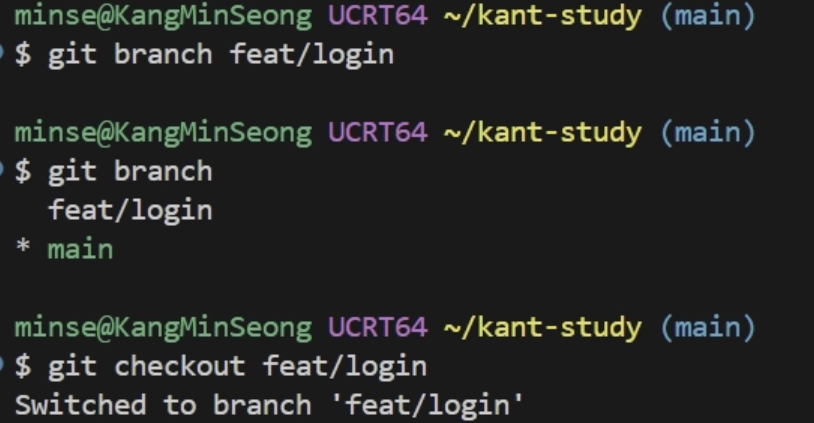

이때, branch 삭제 시에 delete 명령을 사용하는데

—delete는 안에 아무 변경 사항이 없을때,

-D는 있을때 강제로 삭제 시에 필요

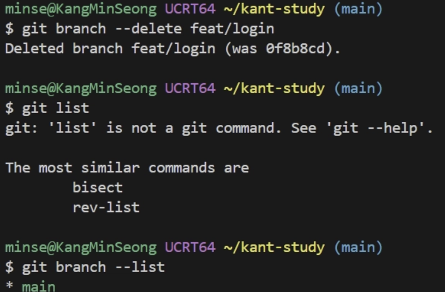

이 명령을 한번에 하는 방법 : git checkou -b 브랜치명 

하면 한번에 그 브랜치까지 간다.

### 6. merge 하는 방법

다른 곳에서 작업한 브랜츠가 main으로도 왔으면 할때, merge 하면 된다.

요약하자면, 수정된 브랜치를 합치기 원하면, 수정할 브랜츠로 가서 머지한다.(fast forwarding)

사용법 : git merge 브랜츠명

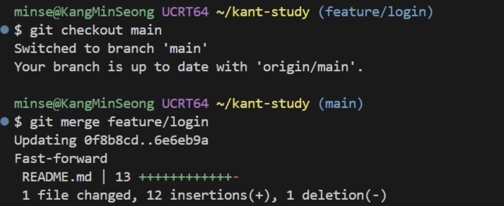