# 2026-10-30 THU TIL(파이썬 기초 + 정보)

### 1.  방식

컴파일 방식 →  소스 전체를 한번에 번역해서 실행

인터프리터 방식 → 한줄씩 읽어가면 실행

파이썬으로 개발을 하려면, 의존성이 중요한데, 이때 파이썬 버전을 여러개 설치해야하는 상황이 옴. 

하지만 일일이 설치한다면, 오염이 되기에 가상 저장소를 만들어서 다 설치하고 나서 개발 진행 후 삭제하는 형식으로 해야함.

이를 방지하기 위해서 가상 저장소를 만들어야하는데 이때 필요한 패키지가 uv 패키지 이다.

### 2. 파이썬 기초

파이썬 안깔린 상태에서 터미널 실행 

→ uv run 파일명.py (가상 저장소랑 연결됨) 자동으로 파이썬 버전이 다운로드 됨

파이썬 버전 지정하는 방법 : uv init —no-package —python 원하는 버전

여기서 항상 중요한 것은 초기화인데, 모든 프로젝트를 구조화하거나 파일을 만들고 난 후 무조건 init 초기화를 해야한다. 그 후 항상 첫번째 commit 이 제일 중요하다. 

이유는 프로젝트가 망해도 첫 commit으로 돌아가면 되기 때문이다. 

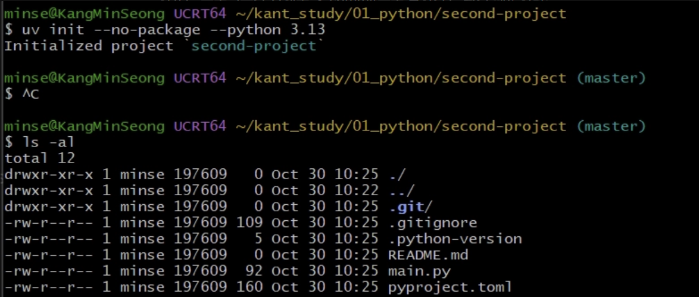

그러면, 이제 버전이 잘되어있는지 확인을 해야할텐데, 이때, cat 명령어를 사용하면 된다.

→ cat .python-version 하면 버전이 나온다. 

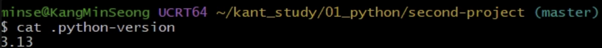

가상 저장소에서도 실행이 되는 지 + 버전을 확인해보자

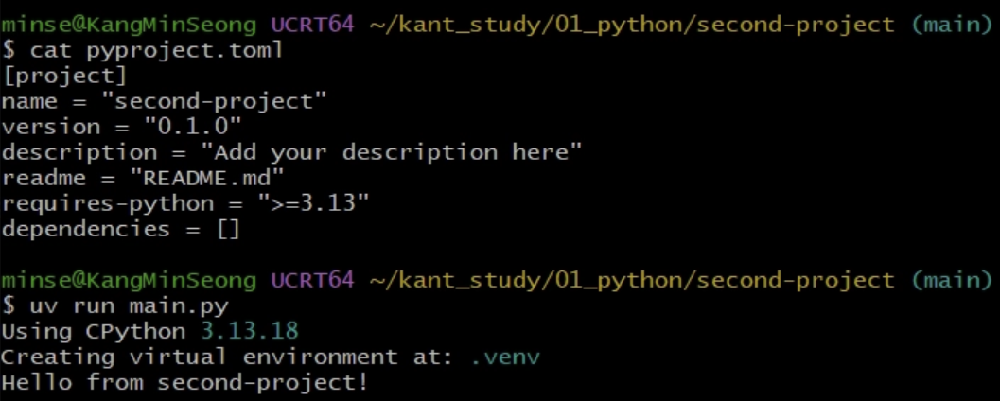

버전이랑 실행이 되는 것을 확인할 수 있다.

이제 버전을 고정하는 방법이다.

기존 버전에서 uv python pin 버전 하면 버전을 업데이트를 할 수 있다.

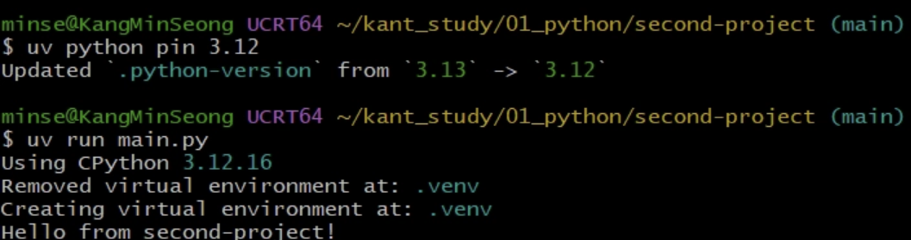

바뀐 것을 볼 수 있다.

이제 의존성을 추가 해보자

uv add fastapi 하면 의존성이 추가가 되는데

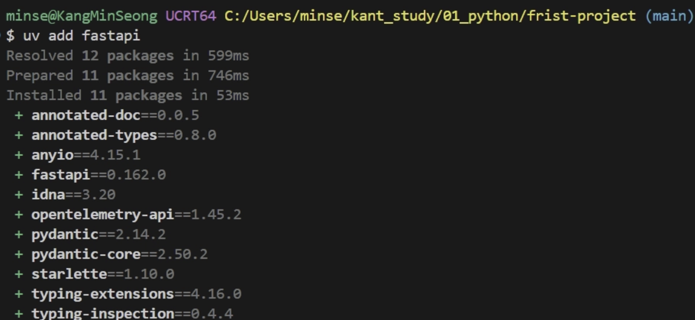

fastapi 의존성이 추가가 되었다.

그리고 내 파일의 트리 구조를 보고싶으면 uv tree -depth 깊이 하면 볼 수 있다.

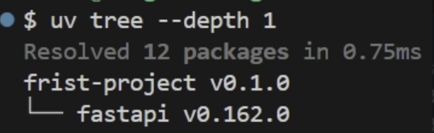

이제 의존성을 삭제하는 법도 배워보자.

방법 : uv remove fastapi 

하면 앞선 설정된 의존성이 사라지게 된다.

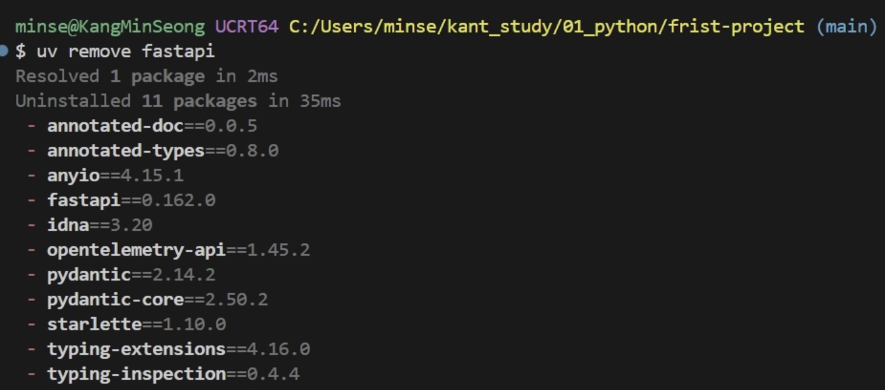

이렇게 사라진다.

이제 가상 환경에서 바꾼 버전이 uv.lock에서는 안바뀔 수도 있는데 이때는 동기화해줘야한다.

uv sync 하면 가상 환경  .venv와 uv.lock 버전이 똑같아 진다.

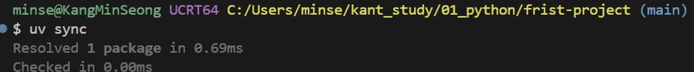

여기까지가 uv(가상 환경) 파이썬 버전을 바꾸거나 업데이트 하는 방법이였다.

이제 터미널에서 가상으로 실행해보자

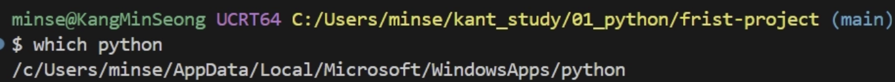

현재는 윈도우로 실행이 되고 있는데 이를 가상 환경으로 바꿔보자.

방법: source .venv/Scrpits/activate 하면 가상 환경으로 바뀐다.

여기서 source는 환경 변수를 바꾼다 라는 의미이다.

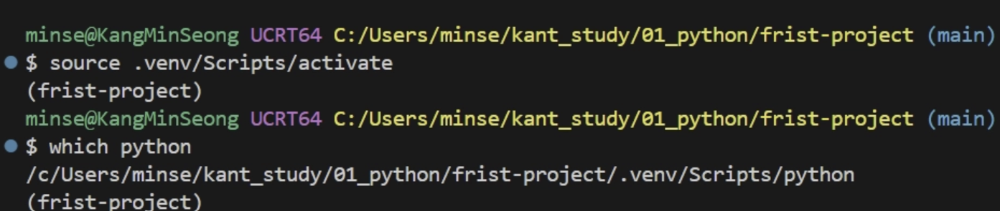

이렇게 하면 .venv로 올 것을 볼 수 있다.

이제 가상환경에서 나가보자.

방법: deactivate

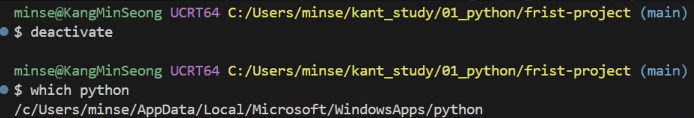

윈도우로 돌아온 것을 볼 수 있다.

ps. 터미널에서 실행하기 → uv run , python 하면 실행됨 이때 두 명령어는 독립 개체임 (간단한거 할때 쓰기)

### 3. 쥬피터 노트북 실행하기

파이썬할때 좋음.

**단축키 : ctrl + shift + x(확장팩으로 가기), ctrl + shift + e(파일로 가기)** , ctrl+shift+p(팔렛트 열기)

쥬피터 노트북 사용하는 방법

→ 커널과 통신

방법 : uv add ipykernel ( 연결 완)

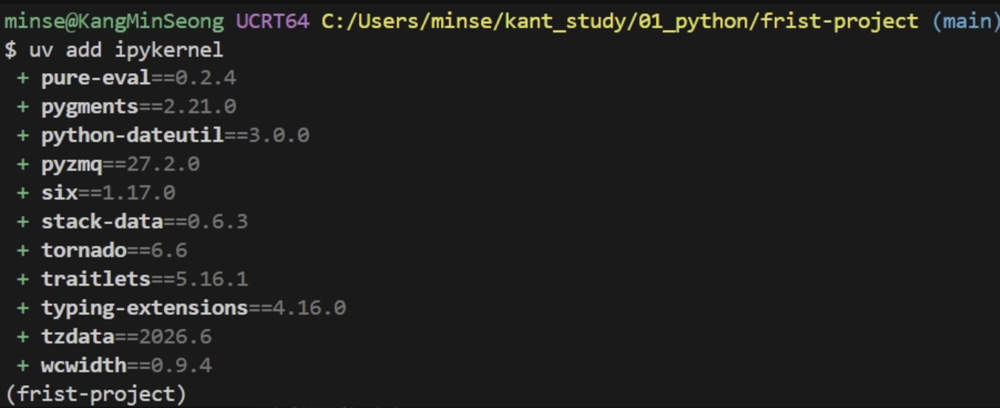

이러고 commit 

이제 쥬피터 모니터에서 파이썬을 해보자

먼저 .ipynb 확장자 파일을 만들고, 

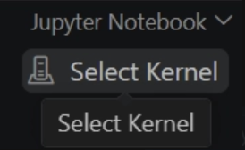

옆에 있는 select Kernel를 누르면 해당 폴더 쥬피터 모니터로 파이썬을 작성할 수 있다.

그 뒤 code추가해서 작성하면 된다.

여기서부터 단축키가 중요한데 빈셀을 지우고 싶으면  명령모드에서(esc) dd를 누르면 삭제가 된다. 잘못 삭제했을 때 z하면 되돌리기가 된다.

기존 셀에 위에다가 추가하고 싶으면 a를 누르면 된다.

기존 셀 다음에 추가하려면 b를 누르면 된다.

마크다운으로 변경하는 방법은 해당 셀 위에 두고 esc + m 누르면 마크다운으로 된다.

y는 code이다.

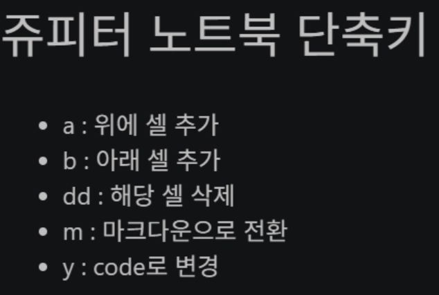