# 2026-11-02 mon TIL(파이썬 기초)

---

### 1. cli 설치
winget install --id Github.cli 해서 터미널에서 설치
설치가 완료가 되었다면, 인증을 하라고 할텐데, 다 enter 누르고 넘어가면 마지막에 인증 코드 오는데 그거로 인증하면 끝

gh repo list로 내 리포를 확인해보자!

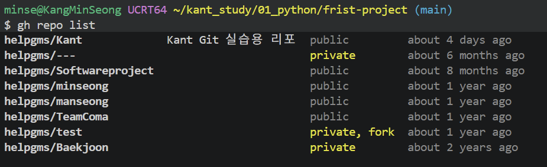

내 레포가 나오고 이제 터미널에서 리포를 만들 수 있다.

이제 터미널에서 repo를 한번 만들어보자.

gh repo create 리포명 --옵션(public, private)

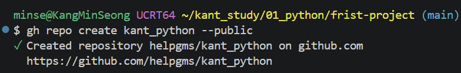
이렇게 하면 만들어진다.

---

### 2. 연산자

논리 연산자는 총 3개로 표현할 수 있다.
1. and (둘 다 참)
2. or (둘 중 하나)
3. not (부정)

사진으로 보자
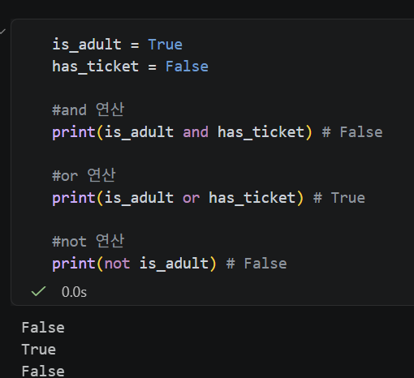

연산 우선순위
사진으로 이해하자

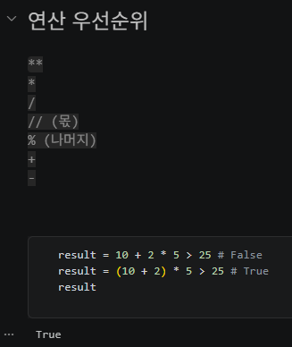

---

### 3. 출력

1. 기본
전에 많이 쓰던 방식으로 가장 기본이 되는 출력법
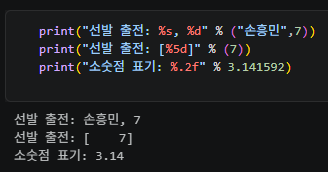

2. format, f-string 방식
이 방식은 직접 안에 넣는 방식이 아니라 변수에 있던 애들을 끌어와서 하는 방법이다.

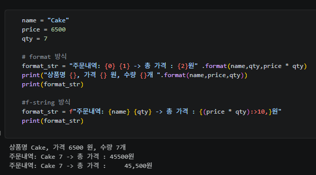

---

### 4. 자료 구조

1. 리스트(list)와 튜플(Tuple)

- 리스트(lisst) : 수정 가능
  -> 대괄호 [ ]

  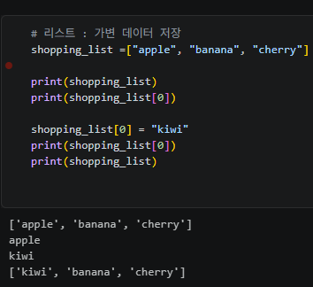

  리스트 메서드 

  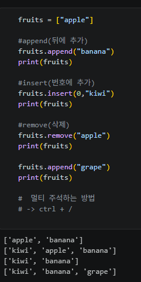

- 튜플(Tuple) : 한번 생성하면 요소를 추가, 생성, 삭제할 수 없다.
  -> 소괄호 ( )

  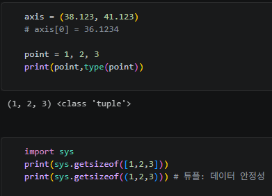

- 딕셔너리 : 키와 벨류값을 가지고 있음
  -> 중괄호 { }

- 인덱스 : 번호
  -> 정방향 : 0, 1, 2
  -> 역방향 : -3, -2, -1

  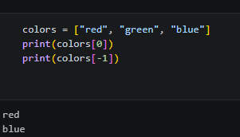

---

### 5. 슬라이싱

1. 슬라이싱 : 정렬할때 이용

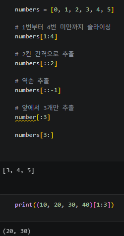

2. matrix : 행렬, 머신러닝할 때 필요

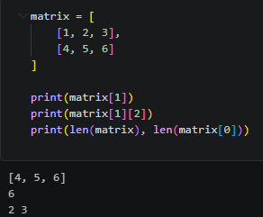

---