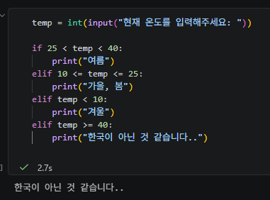
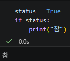
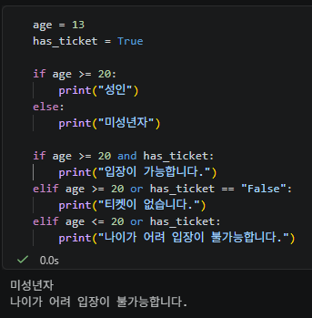
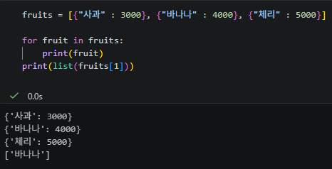
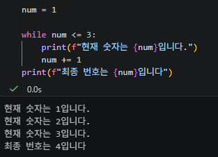
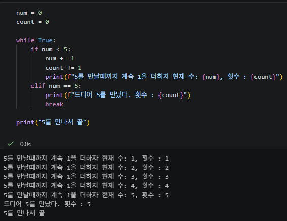
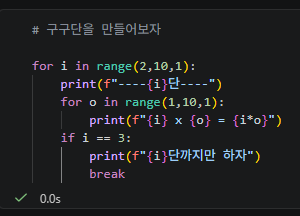
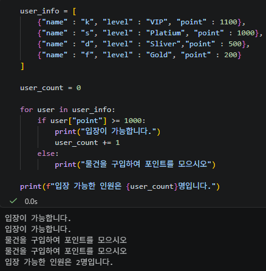
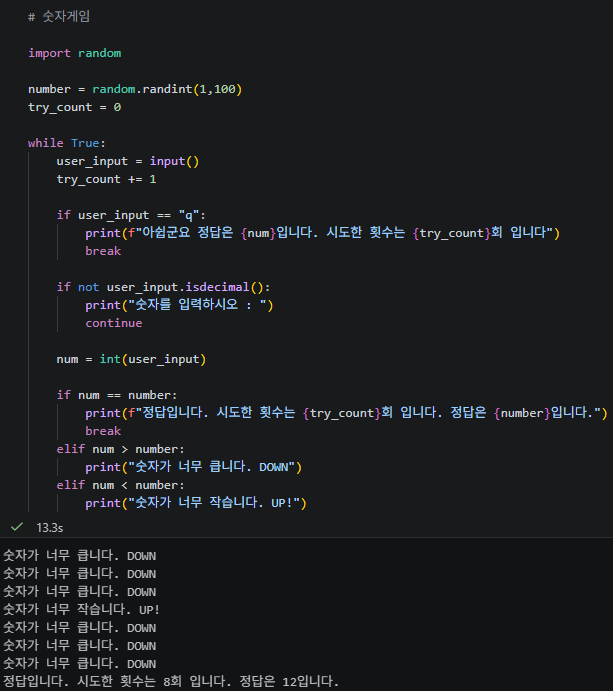

## 2026-11-03 TUE TIL(제어문)
---

### all. 조건문 실습

오늘은 제어문 중에서 조건문과 반복문을 배우는 시간이였다.
그래서 오늘은 간략하게 나 혼자 변형해서 실습을 한 사진을 올릴 계획이다.

1. 현재 온도를 유저가 입력하면 그 온도에 따라 계절을 알려주는 코드를 한번 짜보았다.

사진에서 온도를 44도로 입력하니깐 한국이 아닌 것 같습니다.. 로 나왔다.
이때, 중요한 점은 크기 연산자를 잘 이용해야하는데 이렇게 사진처럼 3항 연산자처럼 사용해도 된다.

2. 참, 거짓

상태에 따라서 참과 거짓을 판별할 수 있다.

3. and, or 연산자를 활용한 조건문

나이와 티켓의 유무로 입장이 가능한지 불가능한지를 판별하는 코드를 만들어봤다.

사진은 나이가 13, 티켓은 가지고 있지만, 나이가 어려서 입장이 불가능한 상황이다.
이때, 약간 헷갈렸던 부분은 and, or 연산자를 어떤 시점에서 써야하는 지 헷갈렸다.
말로는 나이가 20세이상이고 티켓을 가지고 있으면 입장 가능이니 and인 것은 이해했다 하지만, 나이가 20세 이상이지만 티켓이 없으면 or 이라는게 약간 이해가 안되었지만, 말로 하다보니깐 이해가 되었다.

4. 리스트 실습 + 인덱서 활용

과일들의 나열을 출력하고, 몇번째에 무슨 과일이 있는지 확인해보았다.

5. while 문

사실, 나도 while 반복문은 잘 사용하지않는다. 무한루프에 빠진 적이 너무 많아 무섭다.
맨날, vsc를 껐다켰다를 반복했던 기억이 있다...
하지만, 요즘 break문을 잘 활용한다. 또 이번 실습을 통해 또 한번 break문의 활용성을 또 알았다.

5-1. while 문 실습 

이번 실습은 5를 만나면 끝나도록 하는 코드이다.
num이 5를 만날때까지 반복하는 것이고, 그러면서 num이 1씩 증가하여 5를 만나게 된다.

5-2. 구구단 만들기

구구단 만들기

6. 딕셔너리 실습

딕셔너리를 이용한 반복문 실습이다.

7. 마지막 심화 실습

내가 알던 input방식으로 하면 문자가 나왔을때는 오류가 난다. 하지만, 이렇게 둘로 나누면 변수 조정이 가능하다.
여기서, isdecimal() 메서드를 통해, 정수가 아닌 입력값을 받아도 다시 시도하게 할 수 있었다.
그리고 이 실습을 통해 코드의 순서도 중요하다고 느꼈다. 
순서 하나의 차이로 오류가 나고 원하는 결과값이 안나오고 그런다.

배웠다.