# 2026-11-04 WEN TIL(Function 함수)

## Function 함수

- 단독적으로 사용 가능 ex. print(), len(), ...
- 매개변수(Parameter)
- 반복되는 로직을 합쳐놓은 문법
- 재사용 높일 수 있는 코드 기법
- 함수명 컨벤션: snack_case 사용

함수는 만들때, 정의할 필요가 있다. 내가 약한 코딩을 하면서 약한 부분이 있는데 그게 바로 함수 생성 후 변수 범위의 혼동이다.
오늘 이 부분을 집중적으로 배워보는 시간이였다. 지금은 여러 실습을 통해 이해했지만, 그 전에는..., 지금 여전히 어렵다! 해보자!

함수에는 매개변수를 할당해야할 때가 있는데 그때의 매개변수는 여러개 할 수 있지만, 딱 3개까지가 적당하다고 생각한다.

오늘 실습을 사진으로 확인해보자 
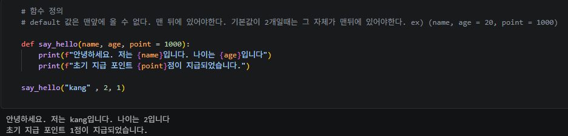
이 실습은 매개변수 3개를 넣은 상황이다. 여기서 중요한 점이 있는데 매개변수를 설정하고 매개변수를 할당해주지 않으면 오류가 난다.
그래서 이를 방지하기 위해 기본값을 설정해놓는데 그것 또한 위치가 중요하다. 마지막에 있어야 기본값이 할당이 된다.
예를 들면, (name, age = 20, point = 1000) 이런 식으로

이제 가변 인수인데, 점점 수많은 개념들과 정보들이 머릿속으로 들어오고 있다. 이제는 복습을 넘어 몸에 익숙해져야할 듯!

사진으로 확인해보자
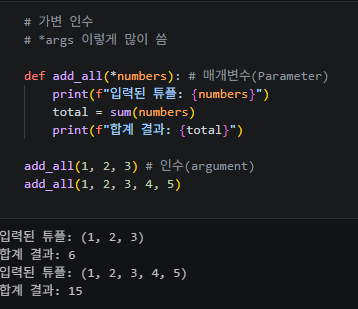

가변 인수는 * 를 이용한다. 매개 변수에 가변 인수를 설정하면 이 후 값이 변할때마다 값이 달라진다.

이와 비슷한 딕셔너리 가변 인수이다.
이것도 먼저 사진을 확인해보자
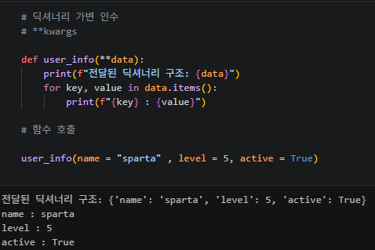

딕셔너리는 키와 벨류를 표하는 법인데, 이를 가변 인수로 하여 나타낼 수 있다.

return 반환값 되돌리기
이것은 내가 C언어를 엄청 공부했을때 많이 접한 부분이라 반가웠다. 이 부분은 엄청 이해하기 수월했다. C는 절대 쓸모없을 줄 알았는데..

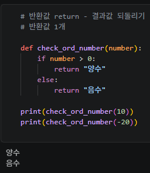
조건식에 맞는 값으로 리턴해준다.

이번엔 여러개의 결과값을 반환해보자. 여기서 몇가지 정보를 얻었다!

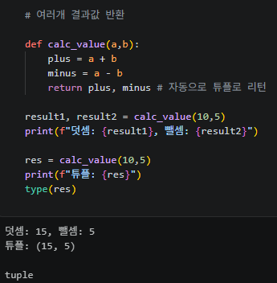
사진을 보면 plus, minus로 자동으로 튜플로 리턴하고 있다.
하지만 res1, res2 이 부분의 타입은 Int로 찍한다. 그 이유는 튜플처럼 묶어서 () 안에 나타내주는 게 아닌, Int로 각각의 변수의 인수로 표현되어있기에 Int로 찍힌다. 하지만, res를 보면 타입이 튜플로 찍힌다. 이것은 각각의 변수의 인수로 나타낸게 아닌, 변수가 1개이므로 묶어서 튜플로 나타냈기에 타입이 튜플로 나온다!
이 정보를 얻었다. 신기했다!

다음은 내가 직접 해보는 실습이였다.

사진으로 먼저 보자
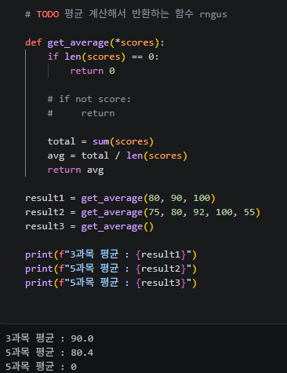

딱 봤을때 드는 생각은 다 합쳐서 개수만큼 나눠야지! 라는 생각이였는데 막상 코드로 표현하려니깐 내가 고장이 나버렸다...
천천히 해보자. 처음에는 len()함수를 이용할 생각은 못했다. 그래서 그냥 하드코딩으로 개수를 직접 입력했다. 
하지만, 튜텨님의 실습을 보고 깨달았다. 그 개수를 len()이라는 함수를 이용하면 바로 나온다는 것을!! 이제는 개수 구할 때 가장 먼저 len()이 생각날 것 같다.

이번엔 좀 더 심화된 코드 실습 미니 계산기를 만드는 실습을 해보자
먼저 사진으로 보자
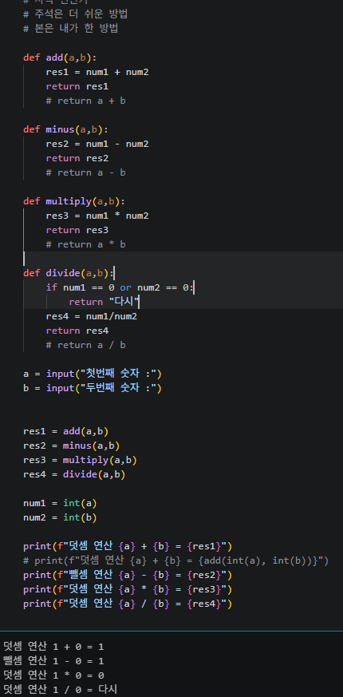

이번에도 내가 직접 일일이 계산해주고 return했다. 하지만 반환값에 바로 연산식으로 넣으면 된다. 사실 나도 저 방법을 이용했다. 하지만 결과를 출력해봤을 때, 오류가 났다. 그 오류는 바로 사용자가 입력한 값이 정수가 아니라는 오류였다. 그렇다 파이썬은 정수 지정을 안해주면 문자열로 출력된다. 그래서 결과가 이상하다. 1 + 2 = 12 이런식으로 나왔다.
그러나 add(int(a)) 이렇게 정수 표현을 해주면 되는 쉬운 실습이였다. 아쉽다..

다음은 내가 C를 할때, 꽤나 골머리 썩었던 파트이다. 그건 바로 변수 스코프(유효 범위)이다.
이건 내가 조건문, 반복문, 함수 생성을 할때 블록이 생성되는데 나는 그것도 모르고 왜 변수(지역변수)가 지정을 했는데 (지역 외) 여기서는 안되는거지로 스트레스를 많이 받았었다.

지역변수는 간단하다. 함수 내에서 선언하는 변수로 함수 안에서만 접근이 가능하다. (지금은 충분히 이해했다.)
전역변수는 어디서나 접근 가능으로 함수 밖에서 선언하는 변수이다.

지역변수 실습을 사진으로 보자
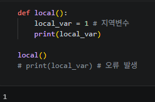
항상 저렇게 하고 오류가 난다고 스트레스를 받았었다....

전역 변수이다. 
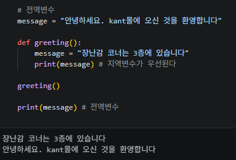
말 그대로이다. ㅋㅋ

이번엔 global 키워드이다.
이건 전역변수를 참조하여 함수 내에서 진행한 로직들을 함수 밖에서도 쓸 수 있다.
사진으로 보자
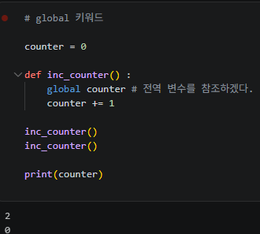

함수 내에서 했던 로직들이 함수 외에서도 되는 것을 볼 수 있다.

다음은 람다식인데... C언어로 배웠을때는 뭔소리인지 몰랐는데 파이썬은 뭔가 간단 명료하다. 눈으로 봐도 이해할 수 있을 것만 같다. 실상은 아니지만..;;

lambda 매개변수 : 표현식(로직) 으로 표현한다.
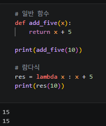

람다식은 조건문을 짧게 표현할 수 있다.
더 나아가 실습으로 보자

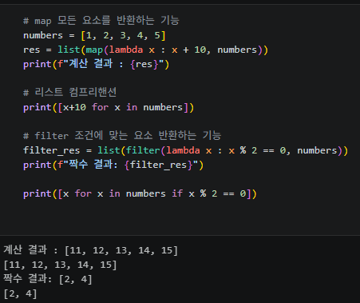

map은 모든 요소를 반환하는 기능이고, filter는 특정 조건식에 해당하는 값들만 추출하는 기능이다.

다음은 정렬이다. 내가 C언어를 할때 정렬을 좋아했다. 최대공약수 공식이 정렬을 사용한다.

파이썬으로 한번 보자
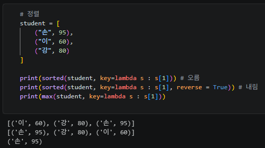

오름차순으로 기본적으로 정렬이 되고, 내림차순을 원하면 reverse = True, 최댓값은 max이다.

다음은 마지막 직접 실습으로 람다식을 이용하여 조건에 충족해야하는 실습이다.
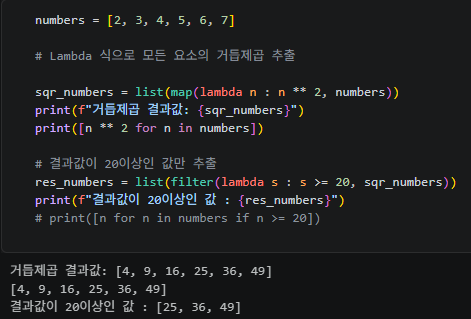

먼저 리스트로 num이 주어졌고, 나도 리스트처럼 펼쳐서 요소들을 보고싶다 그래서 list를 이용했다.
그리고 람다식을 이용하여 한줄로 제곱을 표현하였고, map를 통해 전체 요소를 추출했다.
그리고 filter를 이용해서 조건에 맞는 요소들을 추출하는 것까지하면 끝이다!

어느 정도 함수와 변수 스코프, 람다식을 이해할 수 있었던 시간이다.
되돌아보니깐, 이런 정보들과 개념들을 조금만 알고 있는 상태에서 코딩 알고리즘을 풀었던 옛날의 시간들이 약간 아쉽다. 지금은 어느정도 감이 잡히는 단계이다. 아직 완벽한 건 아니다. 하지만, 이해했다. 이해했으니 직접 해보는 단계이다. 손이 익숙해지면 완성이 될 것 같다.
직접 실습하는 시간들을 가지니깐, 더욱 더 재밌고, 나의 약점을 알게 되고, 성장하는 기분이다. 시간도 빨리 간다. 실습을 완료하면 뭔가 뿌듯하다. 앞으로 더 많은 실습들이 남아있을텐데, 괜찮다. 좋다. 나의 약점을 더 알 수 있고, 성장할 수 있어서.

오늘의 TIL은 나의 진짜 일기와 같이 작성했다. 이게 더 맞는 느낌이랄까?
내일 TIL도 기대가 된다. 

끝.