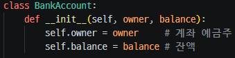
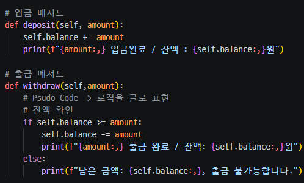
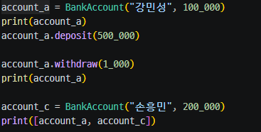
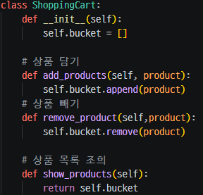
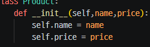
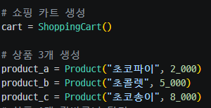
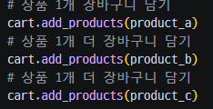
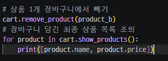

# 2026-11-05 THU TIL(class 생성)

### class
- class 정의 : 붕어빵 틀
- 인스턴스 생성 : 붕어빵 만들기

클래스는 코드를 만들기 전에 구조화하는 것이라 생각한다. 클래스없이 코드를 쫙 짜보면 엄청나게 길고 길 뿐만 아니라, 더러워진다.
이를 방지하기 위해 클래스를 선언하는 것이라 생각한다.

오늘은 실습 위주로 진행했기에 사진으로 대체 한다.

먼저 예금주를 만들어주고 그가 가진 금액까지 선언해준다.

그 뒤에 입,출금 함수를 선언하여 구조화해주고, 그 안에서 조건식 및 연산을 할 수 있도록 한다.

그럼 다음 마지막에 매개변수에 넣고 싶은 값들을 할당하여 각 함수에 넣을 수 있게 할당해준다.

클래스와 함수를 만들지 않았더라면, 일일 전역변수에 한번에 변수를 할당하고 뒤에 계속 변수값이 바뀌어 계속 말도 안되는 결과값이 나올 것이다.
이를 방지하기 위해, 또 좀 더 깔끔한 코드를 위해 클래스와 함수를 선언하는 것이다.

마지막, 오늘의 실습으로 쇼핑카트를 만드는 것이다. 
딱, 이 주제가 들어왔을때 뭐부터 해야하는지 잘 모르겠었다. 그래서 psudo 코드를 이용하여 한글로 내가 필요한 것들을 쓴다.
그걸 따라 코드를 진행하면 쉽다.

쇼핑 카트 만드는 것에 제일 먼저 해야하는 것은 뭘까?
먼저, 쇼핑카트를 만들어주고 그 안에서 추가하고 뺄 수 있는 기능을 추가해주자

 
 그 다음은 상품들의 목록을 만들어줘야한다.

이렇게 상품 클래스 선언해주고, 초기화 해준다.

이렇게 까지 해주고, 진짜 담을 수 있는 카트를 생성해준다.
앞서 만든 카트 클래스를 가지고 와서 생성해준다.
그래야 그 안에 기능을 사용할 수 있기 때문이다.

이렇게 생성해주고 이 생성한 상품들을 담을 수 있게 해줘야한다.
이때, 카트 클래스 안에 있는 add_product 함수를 append 해줬기에 가져와서 상품명만 작성해주면 담을 수 있다.

그 후 제거 하는 기능도 해보자

제거와 조회까지 할 수 있다.

이렇게 좀 복잡하지만, 있으면 좋은 기능들이다.

오늘은 이렇게 실습을 마쳤다.