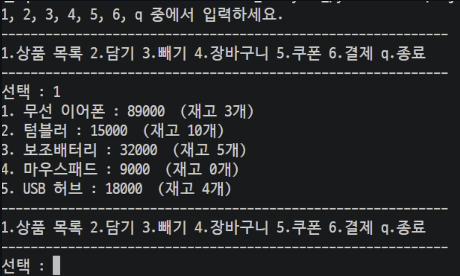
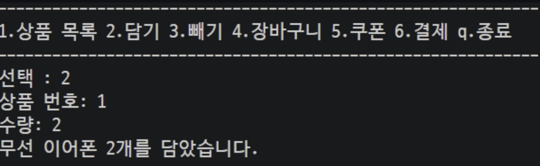
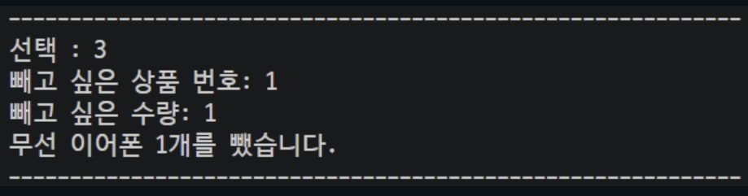
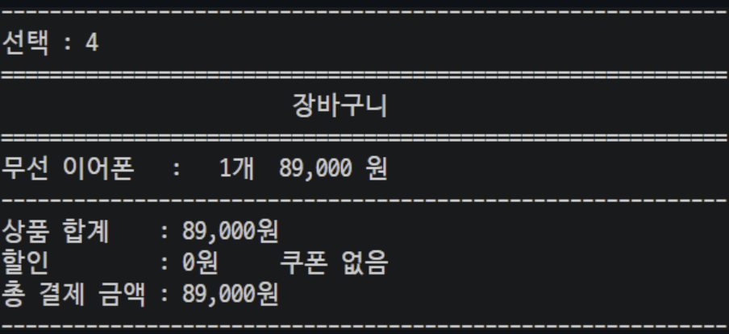
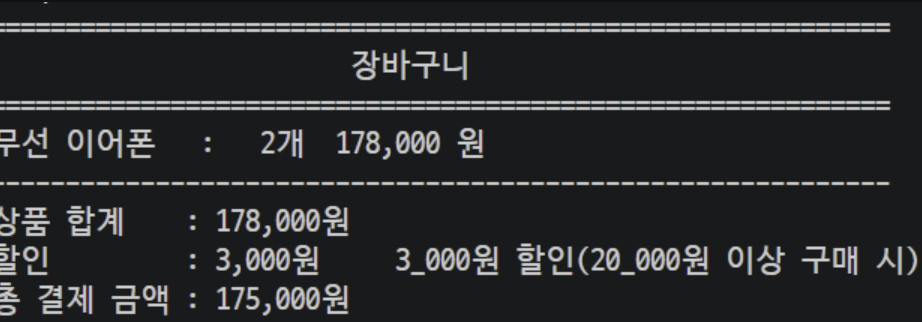
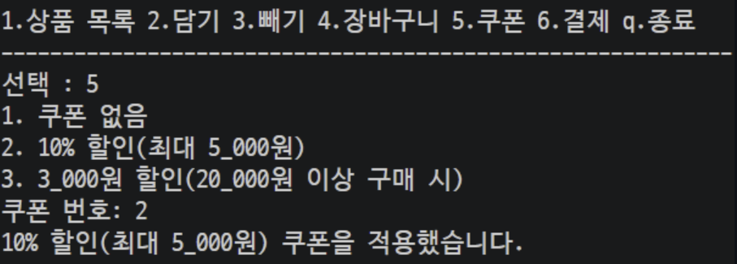
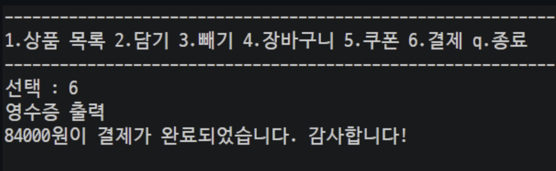
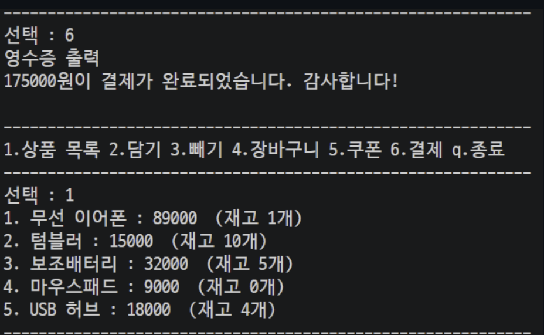
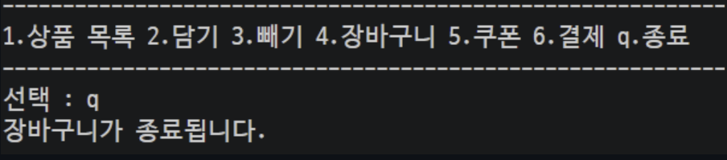

# 미니 프로젝트 2 (쇼핑 카트 만들기)

- shoppingCart.py로 진행

### 간략히 코드 설명하자면..

- 쇼핑 리스트를 딕셔너리 안으로 정리했고, key은 번호, value는 리스트로 묶었다. 리스트 안에 상품명, 가격, 재고 수량으로 해서 리스트로 정리했다.
- __init__ 메서드에는 장바구니 생성과 총 금액, 할인된 금액, 유저가 선택한 쿠폰, 쿠폰 종류, 할인 이렇게 정리해두었다.
- user_choice 메서드에는 유저가 메뉴를 선택할 수 있는 로직을 구현했고
- shop_list 메서드에는 상품목록을 딕셔너리의 key를 for문 안에서 도는 변수를 활용해서 쭉 나열할 수 있게 했고, 딕셔너리 인덱스를 활용하여 상품명, 가격, 수량을 볼 수 있게 했다.
- add_cart 메서드에는 상품을 담기 위한 메서드이다.
- 재고량도 딕셔너리를 활용하여 카트 안에 넣을 수 있게 했다.
- remove_cart 메서드 또한 add_cart와 비슷하다.
- show_cart 메서드는 장바구니를 보여주는 메서드이다.
- coupon 메서드는 쿠폰 적용하는 메서드이다.
- payment 메서드는 결제 로직들이 들어있다.
이때, 쿠폰에도 비슷한 로직이 하나 들어가있는데..
이건 따로 계산하는 메서드를 만들면 더 좋을 것 같다.
- run 메서드는 실행하는 메서드이다. 유저가 원하는 메뉴를 선택 시에 그에 맞게 실행이 된다.

### 결과 화면 
- 1번을 누를 때.

- 2번

- 3번

- 4번

쿠폰 적용

- 5번

- 6번

결제 후 재고 수량 감소

- q

### 중간에 확인된 문제점 

- 중간 문제점 : 
- 1. 결제 완료 되었을 때 쿠폰 활용이 안되는 것 같음 해결 하지만 할인 가격이 위에서 0으로 초기화해서 그대로 0원으로 나오는 것 같음 -> 이건 여전히 안됨. -> 해결 완
- 2. 결제가 완료되었는데 장바구니 안에 상품은 그대로 있음 -> 삭제 로직 구현했는데 적용 안됨... 튜플을 리스트로 바꾸니 연산이 되서 해결
- 3. 결제 후 재고가 상품리스트에서 사라져야하는데 안 사라짐. -> 해결 완

- 후반 문제점 : 
- 1. 2만원이 안넘는 물품도 쿠폰 3번인 할인권이 적용됨 하지만 결제에서는 적용이 안됨. 디벨럽할 예정...
- 2. 10% 할인 쿠폰이 5000원이 안넘으면 10% 가격이 총금액으로 출력됨. -> 해결 완
- 3. 가격들이 1,000원 단위로 보기 쉽게 표현 못했음 -> 1번과 함께 디벨럽할 예정.